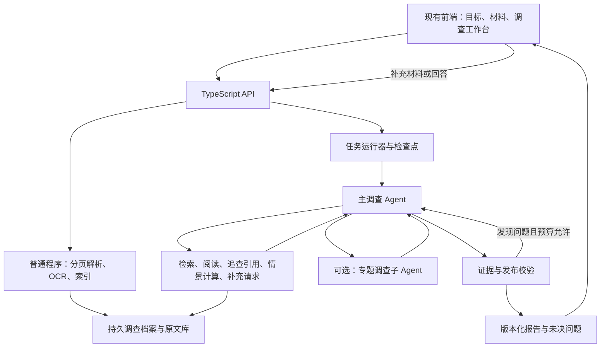

# Policy Lens Agent V2：主动调查与证据工作台

日期：2026-11-13。状态：已完成基础审阅/任务 API、SQLite 持久化、会话隔离、PDF 上传和分页原文引用；已增加初步模型工具循环，OCR、补件续查、独立语义复核与前端接入待实现。当前可用接口见 [后端本地开发](BACKEND_LOCAL.md)。基于现有原生 HTML/CSS/JavaScript 前端、团队选择的 TypeScript 与 DeepSeek。

本文替代旧版 BACKEND_AGENT_PLAN.md 的固定报告流水线设计。核心交付是：用户给出购保目标后，Agent 自己选择调查路径、追查定义和例外、发现缺件、要求补充，并依据新证据继续调查。首次报告、追问和情景研究都使用同一个 Agent 运行器。

实施状态更新（2026-11-14）：队友已完成基础续查、复核、宣传/经纪对照与材料页调查；本次新增主页真实入口、历史/续查对照、主动时长边界工具。详细验收与明确未实现项见 [调查工作台说明](INVESTIGATION_WORKBENCH.md)。下文仍是目标设计，不能视为全部已实现。

## 1. 产品能力与演示主线

| 能力 | Agent 的自主决策 | 用户看到的结果 |
| --- | --- | --- |
| 主动调查 | 把用户关切拆成问题，自选检索顺序，读取上下文并追查附表、定义、批单 | 有依据的结论、已检查范围、尚未解决的问题 |
| 补件后续查 | 判断缺什么及影响范围；有其他可查问题时先继续，剩余问题被阻塞时暂停 | 具体补充卡；补充后保留调查档案继续执行 |
| 反事实研究 | 自选值得测试的条件变化，寻找推翻原结论的条款，必要时调用计算工具 | 情景变化前后的条件对照和证据，不承诺理赔结果 |
| 宣传与合同对照 | 判断主张需要哪些合同条件，核对计划、版本与适用范围 | 有条件支持、表面冲突、材料不足等可解释分类 |
| 经纪回复核验 | 检查回复是否回答原问题、提供依据，决定是否追查或追问 | 回复充分性、原文支持情况、仍待确认事项 |

建议演示：用户问“去日本滑雪，这份旅行险有什么需要先确认？”→ Agent 找活动定义及除外 → 发现条款引用未上传的运动附表 → 给出已能确认的内容，并请求该附表 → 用户上传 → Agent 核对产品/计划，重新检查受影响问题 → 用“普通雪道/越野滑雪”等条件做对照 → 整理给经纪的问题。

演示所用条款和结论必须来自实际样本；不能预设任何产品一定涵盖或排除滑雪。评委能看到实际工具活动、引用和续查结果变化。

## 2. 架构与自治边界



主 Agent 决定下一步调查什么、调用哪个工具、如何修改调查计划、何时需要用户以及何时结束。程序负责权限、解析、存储、工具执行、预算与发布检查。

先实现一个主 Agent。增强版本增加一个可被动态委派的只读专题调查 Agent；它获得独立子目标，自己检索、阅读、找反例，再交回带来源的发现。父 Agent 决定是否采纳。子 Agent 不发布报告、不修改共享结论、不再创建子 Agent；父子共享预算。固定的一次模型复核称为校验调用。

首版不开放任意代码执行、任意文件读取、支付或自动联系经纪。官方附表搜索可作为后续工具：只访问允许的官方域名，保存抓取日期和版本匹配结果；找到的公共文件不能自动当作用户所买计划的一部分。

## 3. 技术实现选择

| 层 | 实现建议 |
| --- | --- |
| 前端 | 保留现有 HTML/CSS/JS 与动画，新增 API、状态和证据模块；React 不是 Agent 的前提 |
| API | Node.js + TypeScript + Express + Zod；同源提供前端与 API |
| Agent 模型调用 | AI SDK + DeepSeek provider/兼容端点；安装时锁定版本并核对其官方文档 |
| 自主循环 | AI SDK 工具循环能力；为了逐步检查点，可用 core API 每次运行一个决策步，再由服务端恢复下一步 |
| 文件 | PDF.js 分页提取；扫描页/图片走独立 OCR/视觉提取，保存识别方式和失败页 |
| 检索 | 先做小材料集的规范化关键词/中文分词或 n-gram 检索与原文扫描；有统一 searchSources 接口后再换检索实现 |
| 持久化 | 单实例演示：SQLite、私有文件目录、后台 worker；所有任务与事件落库 |
| 部署 | 有持久磁盘的 Node 实例；若采用无状态函数，同步替换数据库、对象存储和持久任务系统 |

AI SDK 的 ToolLoopAgent 可提供模型—工具循环，但运行持久化、任务恢复和业务版本检查需要另外实现。已有项目采用非 eve 技术栈，本次以接入现有系统为主；不为了使用 Agent 重建前端。

DeepSeek 的 tool calls 返回待执行的函数及参数，实际函数由服务端实现。JSON 输出仍需要 schema 和业务验证。模型型号、端点、图像能力从服务端配置，并先用团队实际账户测试；不把新版官方能力当作所有代理端点都支持。

中文检索必须用真实样本验证。不能假设 SQLite 默认全文分词就能覆盖中文，或假设 DeepSeek 同时提供所需 embedding API。

## 4. Agent 的调查档案

每个 review 对应一份持续调查档案；聊天记录只是入口之一。持久记录：

- 用户目标与背景事实：明确区分用户填写、文件提取和模型假设；未知信息为空，不默认日本、自己、滑雪。
- investigation_items：每个待查问题、优先级、状态、下一步、阻塞原因。
- findings：候选结论与校验状态，区分 document_supported / interpretation / unknown。
- evidence_links：结论对应哪些原文、定义、例外、用户事实和规则。
- search_scopes：查过哪些文件/章节、完整性及尚未解析的引用；一次搜索无结果不等于合同不存在该内容。
- input_requests：需要的附表、澄清事实或回复；关联受影响的问题，可回答、补件或跳过。
- runs / checkpoints / tool_executions / run_events：执行预算、协议消息、结果和可重放活动。
- reports：不可变的已发布快照；候选内容与正式结果分开。

原文块有稳定 sourceId、documentId、documentVersion、文件页序（1-based）、可选印刷页码、blockId、quote、提取方法及引用检查状态。一条结论可以同时依赖多份文件和多段原文。

所有报告标明输入版本和已处理页数。OCR 引文可在识别文字中匹配仍不代表原件已人工核验；提供页图查看。不能用模型自报百分比表示可靠性。

## 5. 提供给模型的工具

这些是服务端内部工具，不直接等同于浏览器 API。工具的 reviewId、权限与输入快照由服务端绑定，模型不能通过参数切换会话。

| 工具与主要参数 | 程序实现与返回 | 关键约束 |
| --- | --- | --- |
| listDocuments() | 材料类型、产品版本、页数、解析完整性、缺页 | 区分合同、宣传、附表、批单、经纪回复 |
| searchSources(query, filters) | 在当前快照检索，返回 sourceId、原文片段、页码、检索范围 | 命中只表示相关，不能直接作为结论 |
| readSource(sourceIds, contextWindow) | 原文块、相邻条款、所在章节及引用关系 | 保留除外、定义和上下文 |
| resolveReference(referenceId) | 找对应定义/附表/批单；返回 resolved / missing / ambiguous 和候选 | 多个同名附表要核对产品与版本 |
| evaluateScenario(scenario, ruleIds) | 运行已登记的明确条件，返回条件对照、缺失事实、规则来源 | 不由模型任意编代码或补赔付公式 |
| requestInformation(issueIds, request) | 保存补充请求：具体要什么、为什么、影响哪里 | 不可解的问题仍可公开；其余问题继续查 |
| recordFinding(candidate) | 检查来源、版本、类别、数值与依赖；返回校验结果 | 工具执行器落库，候选不会直接发布 |
| finishInvestigation(outcome, openIssueIds) | 请求发布已有成果；程序检查未决项与输入版本 | completed / partial / awaiting_input 由运行器核验 |
| delegateInvestigation(subgoal, focus)〔增强〕 | 创建一个只读专题子 Agent，返回证据、反例、未决项 | 最多 2 个子任务；不递归委派 |

每个工具用 Zod 定义输入和输出；执行前检查权限、快照、长度和预算。结果均为数据，文件中的指令不能修改系统规则。可见日志来自实际工具执行，不能让模型伪造“已检查”。

情景计算例子：只对已明确的“超过 6 小时”返回 350 / 360 / 361 分钟与该字面门槛的对照；还需检查事件定义、起算、除外、证明等。若“每连续 6 小时 200 元”的起算和累积规则不明，返回 insufficient_information。没有足够条件时，不输出确定赔款。

## 6. 运行器如何实现

不是在 Express 路由里等待整份分析。路由验证参数、建立任务、返回 202；后台 worker 从持久队列取任务执行。

```ts
// 架构伪代码：接口名为本项目设计，不是可直接运行的 SDK 代码。
async function executeRun(runId: string) {
  const run = await claimRunWithLease(runId);
  const state = await loadCheckpointAndPinnedInputs(run);
  while (await mayContinue(run)) {
    const decision = await modelStep(state, allowedTools(run));
    await checkpointModelResponse(run, decision);
    if (decision.toolCalls.length) {
      for (const call of decision.toolCalls) {
        await assertRunActiveAndBudget(run);
        const result = await executeToolOnce(run, call);
        await commitToolResultAndPublicEvent(run, call, result);
        state.appendToolResult(call, result);
      }
    }
    // finishInvestigation 工具或模型的最终输出均先作为待校验提案。
    const proposal = await takeOutcomeProposal(run, decision);
    if (proposal) {
      const validation = await validateProposedOutcome(run, proposal);
      if (validation.publishable) return publishWithRevisionCheck(run, validation);
      state.appendValidationFeedback(validation);
    }
    if (await shouldSuspendForInput(run)) return suspendAndRelease(run);
  }
  await publishValidatedPartialOrStop(run);
}
```

实现要求：

1. 保存模型实际返回的 tool call 与对应结果，遵循 provider 协议；不要凭空插入工具调用历史。工具失败作为结构化结果交给 Agent，让它决定换查询、查上下文或请求补充。
2. 工具按 runId + toolCallId 记执行记录；有写入的工具需要事务与幂等。重启不能重复新增问题或发布报告。
3. worker 租约到期可恢复；有未完成调用时先检查执行记录再重试。任务恢复不会只依赖内存或一条未结束 HTTP 请求。
4. 主调查建议起始预算：12 次模型决策、24 次工具执行、120 秒活动执行时间；均为可配置工程预算，依实际测试调整。子任务共享总预算。等待用户不占活动时间。
5. 检测重复查询和无新增证据循环。达到预算时发布经过检查的部分成果与停止原因；没有可用成果则失败，不冒充全部完成。
6. 原文匹配、版本、金额单位等用代码检查；解释与证据是否相符可加独立模型复核。复核失败可退回 Agent 有界修正，不能宣称绝对可靠。
7. 公共事件仅包含动作、事实摘要、引用与状态。内部推理内容不进入前端或普通日志；恢复需要的敏感协议数据按会话权限管理。

## 7. 状态、补件与增量更新

文件状态：uploading → parsing → ready / partial / failed。

Agent 运行状态：queued → running → awaiting_input / completed / partial / failed / cancelled。

awaiting_input 表示这次执行已经释放 worker 并保留检查点；可以同时有一份已验证的部分报告。用户也可以跳过问题，得到明确保留未知项的报告。

版本规则：

- reviewRevision 是业务输入的统一递增版本；后台保存对应的 documentSetVersion、contextVersion、replyVersion 等组成快照。
- 每个 run 固定一个输入快照，执行中不能悄悄换成新文件。新文件 ready、背景变更或补充回复被接受时，事务内增加 revision 并标记旧结果待更新。
- 补充后 resume 创建新 runId，带 parentRunId、同一 review 和检查点关联；旧 run、工具活动与报告保留。
- 每个 review 最多一个 queued/running 主 run。输入改变时取消旧活跃执行（reason=input_changed）；用户选择继续后启动新快照的任务。
- 发布前在事务内检查 run 未取消、review 未删除且 revision 仍匹配。旧结果可以作为历史，不得覆盖当前结果。
- 新材料先查产品、计划及批单适用关系，再根据证据依赖挑出需要复核的问题。新附表可能改变范围，不能保证只改一条结论。
- “未找到”结论也有检索范围和版本依赖；新增材料后必须重新评估。暂不做复杂增量优化时，重查整个相关主题，保留前次档案与变化对照。

## 8. HTTP API 合同

一次调查、追问、情景研究、经纪回复核验统一创建 run，共享权限、事件、恢复与证据结构。

| 方法与路径 | 输入和行为 |
| --- | --- |
| POST /api/reviews | 建立匿名安全会话与 review，返回 reviewId、revision |
| GET /api/reviews/:id | 恢复工作台：材料、版本、活跃 run、当前报告、未决请求 |
| POST /api/reviews/:id/documents | multipart 文件 + role；202 返回 documentId；后台分页解析 |
| GET /api/reviews/:id/documents/:docId | 查询解析状态、页数、失败页；ready 后进入新输入版本 |
| PATCH /api/reviews/:id/context | {expectedRevision, context}；保存用户事实并增加 revision |
| POST /api/reviews/:id/runs | {expectedRevision, kind, goal, reportId?, scenario?, replyId?}；202 返回 runId |
| GET /api/reviews/:id/runs/:runId | 状态、输入版本、当前任务、未决请求、已验证结果、停止原因 |
| GET /api/reviews/:id/runs/:runId/events | SSE：事件落库，支持 Last-Event-ID 或 after 游标重放 |
| POST /api/reviews/:id/runs/:runId/resume | {expectedRevision, responses[]}；保存回答/关联已解析文件/跳过，创建 successor run |
| POST /api/reviews/:id/runs/:runId/cancel | 服务端取消；阻止后续工具写入与发布 |
| GET /api/reviews/:id/reports/:reportId | 不可变报告，包含输入版本、来源、范围、未决项 |
| GET /api/reviews/:id/sources/:sourceId | 原文、文件版本、页序、定位信息 |
| GET /api/reviews/:id/documents/:docId/content | 经权限检查提供原件，支持 PDF 页码预览 |
| POST /api/reviews/:id/broker-replies | 保存用户提供的回复及关联 questionId；增加 revision；需新 run 才执行核验 |
| PUT /api/reviews/:id/questions | 保存 reportId + questionIds + 用户笔记；保留旧版问题映射 |
| POST /api/reviews/:id/checklist | 按选定问题及出处模板导出，返回文本/Markdown；不自动发送 |
| DELETE /api/reviews/:id | 取消运行、删除私有材料与派生记录，迟到任务不得写回 |

kind = investigate | followup | scenario | broker_reply_review。reportId 若提供，必须属于当前 review；旧版本作为讨论对象时显式标注历史版本。scenario 的变量、单位和允许值由已登记场景 schema 校验；情景假设仅属于该 run，不能自动写入真实用户背景。创建与恢复任务使用 Idempotency-Key 请求头，避免重复点击启动两次。

resume 的 responses 每项包含 requestId、action（answer / skip）、可选 text 和 documentIds。服务端检查请求归属、文件已 ready/可接受 partial、文件类型及缺页情况；事务内接受回答、更新版本、创建新 run 并返回最终 revision。若文件已经入库，关联它不会再次虚增文件版本。版本冲突返回 409 和当前 revision，前端刷新后再确认继续。

```json
POST /api/reviews/rev_123/runs
Idempotency-Key: example-investigate-1
{
  "expectedRevision": 4,
  "kind": "investigate",
  "goal": "我去日本滑雪，帮我确认最需要在购买前问清楚的保障边界"
}

202 Accepted
{
  "runId": "run_01",
  "inputRevision": 4,
  "status": "queued",
  "eventsUrl": "/api/reviews/rev_123/runs/run_01/events"
}
```

公共事件至少包括 run.status、task.updated、tool.started、tool.finished、input.required、finding.validated、report.published。每条带 eventId、runId、inputRevision、timestamp。真实动作摘要示例：

```json
{
  "eventId": 17,
  "type": "input.required",
  "runId": "run_01",
  "inputRevision": 4,
  "timestamp": "2026-11-13T08:00:00Z",
  "data": {
    "requestId": "req_07",
    "issueIds": ["issue_skiing"],
    "requestedRole": "schedule",
    "message": "活动条款引用了运动附表，当前材料未包含该文件。请补充附表或暂时跳过。",
    "sourceIds": ["source_contract_p12_b3"]
  }
}
```

上例是协议样例，不代表已经找到实际条款。错误统一返回 {error:{code,message,retryable,requestId}}；区分输入冲突、解析失败、模型超时、预算耗尽和取消。SSE 断开不会取消服务端任务；刷新可恢复。取消与停止动效分别处理。

## 9. 前端需要增加的功能与接入点

| 界面 | 要做的内容 |
| --- | --- |
| 材料入口 | 真实上传、材料角色、页数、识别状态、补件；live 与虚构 demo 清楚区分 |
| 背景与目标 | 复用目的地/对象/活动，增加自由问题与未知选项；不把示例默认值当作用户事实 |
| 调查工作台 | 目标、已查问题、当前动作、已验证发现、未决事项；用真实事件表示进展 |
| 补充卡 | 缺什么、关联原文、影响哪些问题、上传/回答/暂时跳过/继续调查 |
| 证据侧栏 | 多段引用、文件名和版本、PDF 页序/印刷页码、打开原件、OCR 状态 |
| 情景实验区 | 后端 schema 驱动输入，改变一个条件后创建 scenario run；展示条件差异和未知项 |
| 经纪回复区 | 每题粘贴回复/上传截图；区分“回复回答了问题”和“有合同依据” |
| 版本与恢复 | 刷新恢复 run；取消 API；旧报告待更新；补件前后结果对照 |

现有文件的接入位置：

- experience.js：把固定 fixtures 状态改为 review/report 状态；renderReading() 渲染后端 findings、sources、scenarios；背景修改改成保存新版本和继续调查。
- experience-chat.js：submit() 目前调用本地 PolicyExperienceData.reply；改为创建 followup run 并订阅事件。showSource() 使用 sourceId，不能继续将 findingId 当原文 ID。
- experience-chat.js：settle()/reset()/destroy() 当前可能直接完成本地 pending 消息；接入后必须拆开动画、订阅与服务端状态，切页不能将未返回答复标为完成。
- policy-workbench.js：目前要求 finding.quote 包含在单一 excerpt 中；live 模式改用文档卡和多来源查看器，不强迫 unknown 结论有虚构 quote。
- 清单的勾选、复制、下载和完成动效可复用；问题使用稳定 ID 并绑定报告版本。
- experience-data.js / policy-fixtures.js 保留 demo 用途，真实失败不能回退成样例成功。
- scripts/serve.mjs 有静态白名单；新模块与现有新增 i18n 文件需在接入时核对。实时版由 HTTP 后端提供，离线 dist 保留 demo 能力。
- 引用原文禁止被界面翻译自动改写；现有 i18n 接入时给原文区添加相应排除标记。

建议新增 api-client.js、review-store.js、agent-run.js、document-upload.js、source-viewer.js、scenario-lab.js。无需先迁 React；模块过大或多人组件协作困难时再单独评估。

## 10. 后端目录与分工

```text
server/
  index.ts                 HTTP 服务、会话与静态资源
  routes/                  reviews / documents / runs / reports / sources
  contracts/               Zod 请求、事件、工具与结果 schema
  agent/
    investigator.ts        目标、调查规则与模型调用
    runner.ts              决策循环、预算、暂停与恢复
    tools/                 有类型的检索、阅读、引用、情景、补充工具
    verifier.ts            证据、数字、来源和发布校验
    specialist.ts          可选专题子 Agent
  ingest/                  PDF、OCR、分块、文档元数据
  retrieval/               中文检索与引用解析
  worker/                  队列领取、租约、重试与恢复
  repositories/            数据事务、版本、检查点与事件
  storage/                 私有文件访问；运行数据不要放静态目录
```

三人可分：A 文件/API/存储/worker；B 调查 Agent/工具/校验/评测；C 前端状态/事件/补件/证据查看。先共用 contracts 和一套脱敏样本，使用同一事件协议联调。经纪回复可作为核心演示稳定后的扩展。

实施里程碑：

1. 真文档 → 分页引用 → Agent 自选检索/阅读 → 一个带来源的回答；同时打通 run、事件、数据库。
2. 完整调查档案 → 发现引用缺件 → 部分报告 → 补件续查 → 版本变化对照。这是优先保证的亮点。
3. 可交互情景研究 → 明确条件计算 → 未知条件追问；完成一页概览、宣传对照和提问清单。
4. 再加入专题子 Agent、经纪回复核验或限定官方资料搜索。每项需能证明提高调查质量。

## 11. 验收标准

- 自主性：相同目标遇到“定义已在正文”和“缺附表”两份材料时，实际工具路径不同；不是始终按同一固定步骤输出。
- 反例：正文表面支持某场景、后页除外限制它时，能追查到相关例外并调整结论。
- 续查：缺件时明确指出文件与原因；刷新、服务重启后仍能补充继续，保留此前来源与未决项。
- 证据：不存在的 sourceId、越界页码、错误版本、无依据金额不能发布；低质量 OCR 显示待核验。
- 增量：新文件改变适用范围或补足“未找到”项时，相关结论被复核；旧 run 迟到结果不覆盖新版。
- 情景：阈值前/等于/刚过、起算不明、单位/币种、单次/累计上限不混淆；不自行编赔付公式。
- 回复：经纪说“都可以”时保留未获证据的问题；回复与合同来源分开。
- 系统：重复点击、SSE 重连、取消、模型限流、预算耗尽、部分解析失败、两会话隔离均有可解释状态。
- 文件内容包含工具指令时不能改变权限。所有接口检查所属会话，上传目录与 key 不公开，模型文本安全渲染。
- 上传前说明材料用于第三方模型分析并支持删除；初始文件数量/页数是可配置预算，必须允许附表/批单补件，不静默丢页。

## 官方实现参考

- [DeepSeek Tool Calls](https://api-docs.deepseek.com/guides/tool_calls/)：模型选择函数，应用执行工具；具体协议以实际端点为准。
- [DeepSeek JSON Output](https://api-docs.deepseek.com/guides/json_mode/)：JSON 模式和空白/截断处理。
- [DeepSeek Vision](https://api-docs.deepseek.com/guides/vision/)：当前官方图像输入能力；PDF 仍需本项目分页处理。
- [AI SDK Agents](https://ai-sdk.dev/docs/agents/overview)：模型、工具与循环；ToolLoopAgent 与 core API 的选择。
- [AI SDK Loop Control](https://ai-sdk.dev/docs/agents/loop-control)：控制停止条件与每步上下文。
- [PDF.js Examples](https://mozilla.github.io/pdf.js/examples/)：分页读取与预览。

实施时先验证实际 DeepSeek 模型的 tool calling、中文结构化输出和图像输入；再锁定依赖及配置。本文中的接口与伪代码是项目设计，不代表后端已可运行。
